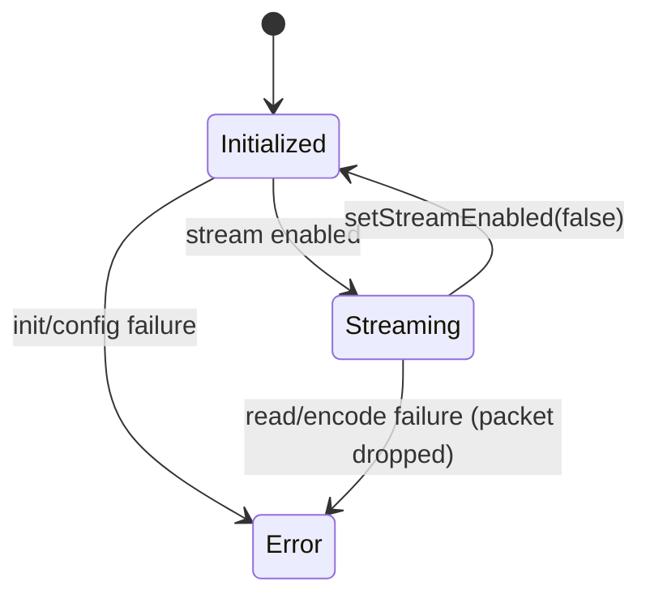
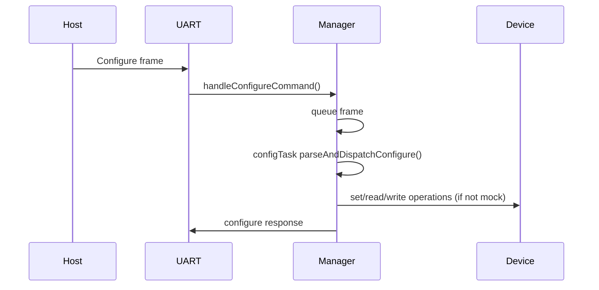

# imu_bmo_055 — Architecture & Internals

## High-Level Design
`ImuBno055Manager` is the public orchestrator; `Bno055Device` encapsulates I2C/Bosch-driver details. Configure RX is decoupled from processing via queue/task. Streaming uses a periodic task with shared stream state and field-mask-based payload encoding.

## Module Structure
| File | Responsibility |
|------|---------------|
| `include/imu_bmo_055.hpp` | Public manager class API |
| `include/imu_bmo_055_types.hpp` | Public config/result/calibration types |
| `include/imu_bmo_055_protocol.hpp` | Protocol constants and enums |
| `priv_include/bno055_device.hpp` | Internal hardware wrapper interface |
| `src/bno055_device.cpp` | BNO055 I2C + Bosch driver integration |
| `src/imu_bmo_055.cpp` | Tasking, command dispatch, stream encode/send |
| `bno055.c`, `bno055_support.c`, `include/bno055.h` | Bosch vendor driver integration files |
| `Kconfig` | Protocol IDs, I2C, stream/task defaults |

## Key Data Structures
- `ImuBno055Manager::StreamState`: enabled/period/mask/mode runtime state.
- `CalibrationBlob`: offset/radius/SIC calibration payload.
- `ImuStreamSample`: staged sample used by stream encoder.

## State Machine

## Task / ISR Layout
| Name | Type | Stack (bytes) | Priority | Role |
|------|------|---------------|----------|------|
| `imu_cfg` | Task | `CONFIG_IMU_BMO_055_CONFIG_TASK_STACK` | `CONFIG_IMU_BMO_055_CONFIG_TASK_PRIO` | Dequeue and execute configure commands |
| `imu_stream` | Task | `CONFIG_IMU_BMO_055_STREAM_TASK_STACK` | `CONFIG_IMU_BMO_055_STREAM_TASK_PRIO` | Periodic sample/read/encode/transmit |

## Internal Call Flow

## Memory Usage
- Manager holds mutex, queue, two task handles, cached calibration, optional `Bno055Device` instance.
- Stream/config payload buffers are stack/local fixed-size arrays.

## Hardware Interaction
- I2C master driver (`i2c_param_config`, `i2c_driver_install`, read/write transactions)
- BNO055 register operations through Bosch API
- Timestamping via `esp_timer_get_time()`

## Initialization Sequence
1. Validate UART and create manager mutex.
2. Initialize stream defaults and validate operation mode.
3. Create device (or enter mock/fallback mode).
4. Apply default operation mode when real sensor is active.
5. Create configure queue.
6. Register UART callback for configure message type.
7. Start config task and optional stream task.
8. Mark manager valid.

## Kconfig Influence
All protocol IDs, transport defaults, I2C settings, stream limits, and task/queue sizing are directly sourced from Kconfig symbols listed in README.

## Extension Points
- Add new configure subcommands in `ConfigureSubcommand` and `parseAndDispatchConfigure`.
- Add stream fields by extending `StreamField`, sample struct, and encoder path.

## Existing Detailed Docs
- `docs/internal-architecture.md`
- `docs/protocol-api-guide.md`
