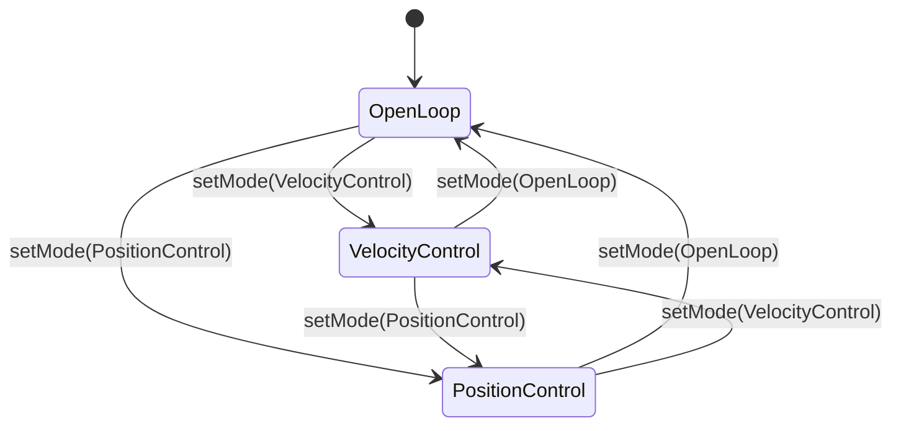

# motor_controller — Architecture & Internals

## High-Level Design
`motor_controller` is an orchestration layer that translates setpoints into motor commands using encoder feedback and PID controllers, while preserving explicit mode semantics.

## Module Structure
| File | Responsibility |
|------|---------------|
| `include/motor_controller.hpp` | Public API, config structs, control mode enum |
| `src/motor_controller.cpp` | Control loop logic and runtime setters |
| `Kconfig` | Default counts/rev and sample-time symbols |
| `CMakeLists.txt` | Dependency declaration |

## Key Data Structures
- `MotorControllerConfig`: startup configuration for conversion and PID settings.
- `MotorController`: owns `Motor`, `Encoder`, velocity PID, position PID.
- Atomics for setpoints/feedforward/cached feedback and conversion parameters.

## State Machine

## Internal Call Flow
- `update()` snapshots mode/config -> reads encoder -> computes output by active mode -> writes motor speed.
- `setMode()` stops motor, reconfigures PID mode/reset behavior, then commits mode under spinlock.

## Memory Usage
- No dynamic allocations in steady-state update path.
- Owned HAL and PID objects are stored directly in class.

## Hardware Interaction
- Delegated to dependencies:
  - `motor_hal` for PWM/DIR writes
  - `rotary_encoder_hal` for count/rate reads

## Initialization Sequence
1. Construct motor and encoder HAL objects.
2. Build velocity and position PID controllers from config.
3. Initialize mode and setpoint/feedback state.
4. Validate output limits and hardware validity.

## Kconfig Influence
- `CONFIG_MOTOR_CTRL_DEFAULT_COUNTS_PER_REV`: default conversion scale.
- `CONFIG_MOTOR_CTRL_DEFAULT_SAMPLE_TIME_MS`: default PID sampling period.

## Extension Points
- Add control strategies by extending `ControlMode` and `update()` switch.
- Add richer telemetry by exposing additional cached loop internals.
