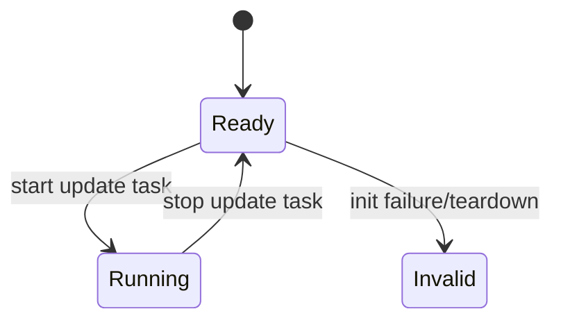

# motor_manager — Architecture & Internals

## High-Level Design
`MotorManager` is a protocol-facing orchestration layer. It stores motor slots keyed by ID, translates UART configure/setpoint payloads into controller operations, and emits compact telemetry frames.

## Module Structure
| File | Responsibility |
|------|---------------|
| `include/motor_manager.hpp` | Public manager class API |
| `include/motor_manager_types.hpp` | Protocol/config/result types |
| `src/motor_manager.cpp` | Core lifecycle, slot operations, telemetry encode |
| `src/motor_manager_uart.cpp` | Configure and setpoint payload parsing/dispatch |
| `Kconfig` | Message IDs, channels, default task settings |

## Key Data Structures
- `MotorSlot`: per-motor ID, telemetry settings, mock feedback cache, optional `MotorController`.
- `ManagerConfig`: protocol IDs, task config, capacity, mock mode.
- `MotorConfigPayload`: binary-config payload decoded from UART.

## State Machine

## Task / ISR Layout
| Name | Type | Stack (bytes) | Priority | Role |
|------|------|---------------|----------|------|
| `motor_mgr_cfg` | Task | `CONFIG_MOTOR_MANAGER_DEFAULT_CONFIG_TASK_STACK` | `CONFIG_MOTOR_MANAGER_DEFAULT_CONFIG_TASK_PRIO` | Parse and dispatch configure commands |
| `motor_mgr_upd` | Task (optional) | `CONFIG_MOTOR_MANAGER_DEFAULT_UPDATE_TASK_STACK` | `CONFIG_MOTOR_MANAGER_DEFAULT_UPDATE_TASK_PRIO` | Periodic `updateAll()` + `publishTelemetry()` |

## Internal Call Flow
- Configure frame -> `handleConfigureCommand()` -> queue -> `configTaskEntry()` -> `parseAndDispatchConfigure()` -> operation + response.
- Setpoint stream frame -> `handleSetpointStream()` -> per-entry `setSetpoint()`.
- Telemetry publish -> `encodeTelemetryLocked()` -> `uart_comm::sendData()`.

## Memory Usage
- `std::vector<MotorSlot>` reserved up to `max_motors`.
- Queue-backed configure pipeline.
- Optional owned `MotorController` objects per slot (or none in mock mode).

## Hardware Interaction
- Indirect via `motor_controller` when mock mode is disabled.
- Uses `gettimeofday()` for telemetry timestamp field.

## Initialization Sequence
1. Create mutex and configure queue.
2. Validate UART and config bounds.
3. Register configure and setpoint callbacks.
4. Optionally create periodic update task.
5. Create configure task.
6. Mark manager valid.

## Kconfig Influence
All protocol IDs/channels and default task stack/priority values come from Kconfig symbols documented in README.

## Extension Points
- Add configure subcommands in `ConfigureSubcommand` + `parseAndDispatchConfigure`.
- Extend telemetry packet fields by updating masks and encoder path.
