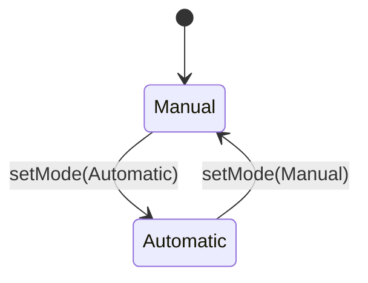

# pid — Architecture & Internals

## High-Level Design
`pid` isolates pure control math from hardware concerns. `PidController` wraps an internal heap-allocated implementation object storing gains, limits, and runtime state.

## Module Structure
| File | Responsibility |
|------|---------------|
| `include/pid_controller.hpp` | Public API and config types |
| `src/pid_controller.cpp` | PID math and state transitions |
| `Kconfig` | Default sample time, limits, derivative alpha |
| `CMakeLists.txt` | Component registration |

## Key Data Structures
- `PidConfig`: initial gain/limit/mode defaults.
- `detail::PidImpl`: runtime state (`integral_sum`, last input/error/output, derivative filter memory).

## State Machine

## Internal Call Flow
- `compute()`:
  1. Validate mode/state.
  2. Calculate error and proportional term.
  3. Integrate with clamp.
  4. Compute derivative (selected mode + filter).
  5. Add feedforward, clamp output, store history.

## Memory Usage
- One heap allocation (`PidImpl`) per controller.
- No additional runtime allocations in compute path.

## Hardware Interaction
- None.

## Initialization Sequence
1. Allocate impl object.
2. Copy config with validation/clamping.
3. Initialize runtime state in Manual mode.

## Kconfig Influence
- All default `PidConfig` fields sourced from Kconfig symbols.

## Extension Points
- Additional anti-windup strategies can be added in compute/integral handling.
- Optional timestamp-based `dt` could be introduced if variable-rate loops are needed.
