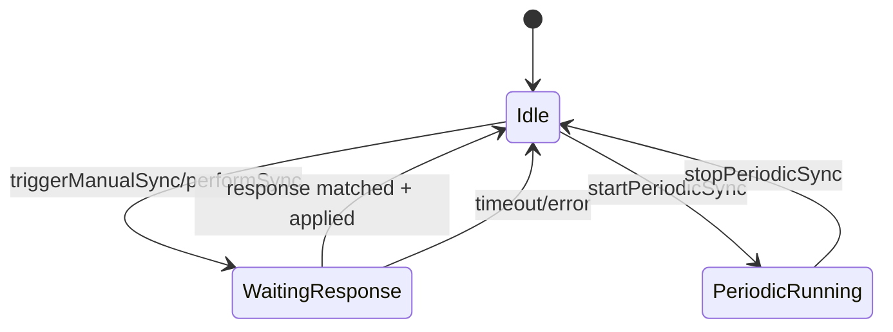

# time_sync — Architecture & Internals

## High-Level Design
`TimeSync` wraps UART messaging and local time updates around a request/response protocol. It keeps transport-specific details isolated from protocol encode/decode helpers and uses queue synchronization between RX callback context and sync logic.

## Module Structure
| File | Responsibility |
|------|---------------|
| `include/time_sync.hpp` | Public API and config |
| `time_sync_protocol.hpp` | Wire-format structs/constants/helpers declarations |
| `time_sync_protocol.cpp` | LE encode/decode implementations |
| `time_sync.cpp` | Runtime logic, periodic task, offset calculation |
| `Kconfig` | Default request/response message type IDs |

## Key Data Structures
- `TimeSyncConfig`: interval, timeout, compensation, message IDs.
- `SyncResponseEvent`: decoded response plus client receive timestamp.
- `TimeSync::Impl`: owns mutexes, response queue, periodic task state, and sync metrics.

## State Machine

## Task / ISR Layout
| Name | Type | Stack (bytes) | Priority | Role |
|------|------|---------------|----------|------|
| `time_sync_task` | Task (optional) | 4096 | 6 | Periodic `performSync()` loop |

## Internal Call Flow
- `performSync()` -> encode request -> `sendCommand()` -> wait response queue -> validate request id/status -> compute offset/RTT -> apply time via `settimeofday` -> update metrics.

## Memory Usage
- One `Impl` allocation plus small queue/mutex/task resources.
- Fixed-size request payload buffers on stack.

## Hardware Interaction
- Uses `esp_timer_get_time()` for monotonic timestamp.
- Uses POSIX `gettimeofday`/`settimeofday` for wall clock access.

## Initialization Sequence
1. Validate provided UART instance.
2. Create sync/state mutexes and response queue.
3. Register response callback.
4. Optionally auto-start periodic task.

## Kconfig Influence
- `CONFIG_TIME_SYNC_REQUEST_MSG_TYPE`
- `CONFIG_TIME_SYNC_RESPONSE_MSG_TYPE`
These seed protocol defaults used by `TimeSyncConfig` and protocol constants.

## Extension Points
- Additional response status semantics can be handled in `performSync()`.
- Advanced filtering/smoothing of offset estimate can be added before `setUnixUs()`.
