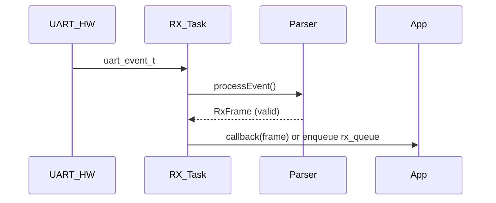

# uart_comm — Architecture & Internals

## High-Level Design
`uart_comm` splits transport responsibilities across parser, frame codec, and runtime tasks. RX task parses driver events into validated frames; TX task prioritizes command frames over stream updates.

## Module Structure
| File | Responsibility |
|------|---------------|
| `include/uart_comm.hpp` | Public API |
| `priv_include/frame.hpp` | Protocol constants and frame codec declarations |
| `priv_include/parser.hpp` | Event-driven parser class declaration |
| `src/frame.cpp` | CRC16 and frame encode/validate |
| `src/parser.cpp` | UART-event parsing and error accounting |
| `src/uart_comm.cpp` | Runtime tasks, queues, callbacks, API plumbing |
| `Kconfig` | UART/protocol sizing and task tuning |

## Key Data Structures
- `RxFrame`: public received frame structure.
- `StreamSlot`: latest payload per stream channel.
- `TxItem`: pre-encoded frame buffer for command queue.
- `UartComm::Impl`: owns all FreeRTOS and UART resources.

## Task / ISR Layout
| Name | Type | Stack (bytes) | Priority | Role |
|------|------|---------------|----------|------|
| `uart_rx` | Task | `CONFIG_UART_COMM_RX_TASK_STACK` | `CONFIG_UART_COMM_RX_TASK_PRIO` | Consume UART driver events, parse frames, dispatch callback/queue |
| `uart_tx` | Task | `CONFIG_UART_COMM_TX_TASK_STACK` | `CONFIG_UART_COMM_TX_TASK_PRIO` | Send queued command frames then dirty stream slots |

## Internal Call Flow

## Memory Usage
- `Impl` heap allocation plus parser heap object.
- FreeRTOS queues for UART events, command TX, and RX delivery.
- Fixed stream slot array (`64` channels).

## Hardware Interaction
- UART driver install/configuration and pattern detection APIs.
- Pattern-detection interrupt queue for frame boundary discovery.

## Initialization Sequence
1. Configure UART parameters and pins.
2. Install UART driver with event queue.
3. Enable/reset pattern detection queue.
4. Create command/RX queues and mutexes.
5. Create parser.
6. Start RX and TX tasks.
7. Mark instance valid.

## Kconfig Influence
All UART selection, protocol sizing, queue depth, task stack/priority, and timeout behavior are directly controlled by Kconfig symbols listed in README.

## Extension Points
- Alternate framing patterns/CRC policies can be added in `frame.*`.
- Parser can be extended for additional UART event behaviors.
